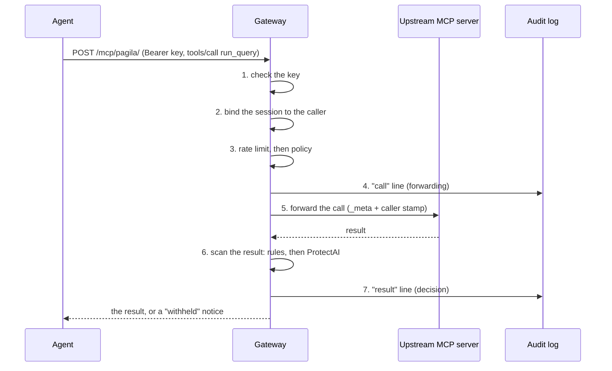
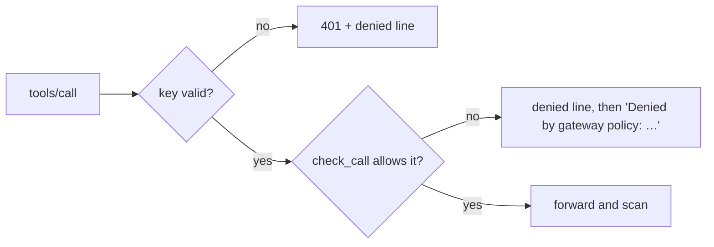
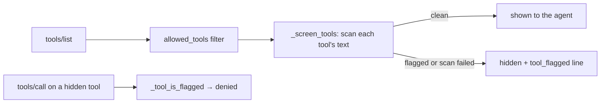

# Guide: how the gateway works

A plain-English walk through mcp-gateway: what happens to one tool call,
what the words mean, and where to change things. The
[README](../README.md) has the results and the
[threat model](../THREAT_MODEL.md) says what it defends against. The
[ADRs](adr/README.md) say why each piece is built the way it is.

## The flow of one tool call

An agent asks the `pagila` route to run `run_query`. The gateway sits in
the middle: the agent talks to it exactly as it would to the MCP server.

1. **Check the key.** `auth.py: ApiKeyBackend.authenticate` runs before
   any MCP code, as Starlette middleware set up in `app.py: build_app`. It
   hashes the Bearer key and compares it, in constant time, with every
   caller's `key_sha256` in the config. A wrong or missing key gets a 401,
   and `app.py: _audit_rejected_key` writes a `denied` line with only the
   key's fingerprint.
2. **Route and session.** `build_app` mounts one MCP app per upstream at
   `/mcp/<route>/`; each one is a `proxy.py: Route`, built in
   `app.py: open_routes`. `sessions.py: SessionGuard` binds a session (its
   `Mcp-Session-Id`) to the key that opened it, and answers any other key
   with a 404 before the MCP SDK sees the request. The SDK then calls
   `Route._call_tool`, a short pipeline of the steps below. `Route._caller`
   reads the caller the auth step found, and `calls.py: start_call` gathers
   what every audit line about this call will carry.
3. **Rate limit, then policy.**
   - `ratelimit.py: CallLimiter.take` counts the call against the key's
     `rate_limit`, if it has one (`Route._rate_limit_refusal`). It runs
     first, so denied calls count too.
   - `policy.py: check_call` checks the route, the tool and each argument
     against the caller's policy. Path arguments are resolved before a
     prefix check (`policy.py: path_within`).
   - `Route._tool_is_flagged` refuses a tool whose description looked like
     an injection (see "Tool-description screening" below).
4. **Write the "call" line.** `audit.py: AuditLog.append` writes a
   `forwarding` line before anything is sent, with the arguments, hiding
   any field with a secret word in its name, such as `api_key` or
   `accessToken` but not `keyword` (`calls.py: redact`). If the
   log can't be written, the call is refused: nothing happens that isn't
   recorded.
5. **Forward.** `Route._forward` asks `upstreams.py` for the client: one shared connection
   (`SharedUpstream`), or one process per session for stateful stdio
   servers (`PerSessionUpstreams`). The call's `_meta` goes along, minus
   the keys that belong to the agent's own connection
   (`calls.py: end_to_end_meta`). The authenticated caller is written under
   `io.github.nabilrobert.mcp-gateway/caller`, replacing anything the client
   put there.
   If the upstream answers with a protocol error instead, that's untrusted
   text too: `outputs.py: screen_error` scans it, passes a clean one on unchanged
   and replaces anything else with a fixed message.
6. **Scan the result.** `outputs.py: inspect_output` runs this step.
   `outputs.py: scan_text` collects the text to scan:
   the text blocks plus the string values of structured content. JSON text
   is unwrapped first (`detect.py: text_for_scanning`), because the
   classifier reacts to JSON syntax itself. JSON keys that read like prose
   (`detect.py: reads_like_prose`) are scanned as a second, separate text
   (`detect.py: scan_output`): mixed in with the values they weaken the
   model's verdict, and it misreads a bare list of field names.
   - `outputs.py: unscanned_reason` blocks what can't be read (images,
     audio, text past the scan cap), unless the policy allows it.
   - `detect.py: LayeredDetector.scan` runs the layers in order and stops
     at the first flag. `detect.py: RulesDetector.scan` matches the patterns
     in `rules/injection.yaml`. `detect.py: ModelDetector.scan` runs
     ProtectAI's classifier in 512-token windows, under a 2 s timeout. An
     output needing more than `max_windows` windows is flagged unread.
   - A flagged output is blocked (`outputs.py: blocked_result`), annotated as
     untrusted (`outputs.py: annotated_result`) or only logged, as the
     policy's `on_suspicious` says. A detector error or timeout blocks it.
7. **Write the "result" line,** with the decision, the detector's verdict
   and a hash of the output (never the output itself), then answer the
   agent.

With tracing on, `rate_limit`, `policy`, `audit`, `forward` and `detect`
are each their own span (`tracing.py: stage`), under the MCP SDK's span for
the request.

## A blocked call

The same request, but the caller's policy allows `run_query` only for
another route, or the tool isn't on its list at all:

- `policy.py: check_call` returns a `Verdict` with a reason, such as
  `tool 'run_query' not allowed`.
- `Route._policy_refusal` writes a `denied` line with that reason and returns
  an error result to the agent. The upstream never sees the call.
- Tools a caller isn't allowed don't appear in its `tools/list` either
  (`policy.py: allowed_tools`).

## Tool-description screening

A tool's description is read by the model like any output, so a malicious
upstream could inject through it.

- `Route._list_tools` filters the upstream's tools by policy, then
  `tool_screen.py: ToolScreen.flagged` scans everything a model can read of
  each one (`tool_screen.py: tool_text`) with the same detector: its name, titles,
  description and the text in its schemas.
- A flagged tool is hidden and gets one `tool_flagged` audit line. Verdicts
  are cached by the definition's hash, so a changed description is scanned
  again.
- `Route._tool_is_flagged` refuses calls to a flagged tool, even if the
  agent never listed tools. It screens against every page of the upstream's
  tools (`upstreams.py: list_all_tools`), and refuses a tool it can't find.

## Start-up and shutdown

- `cli.py: serve` loads the config (`config.py: load_config`) and calls
  `app.py: serve`.
- `app.py: serve` builds the detector (`app.py: build_detector`), opens the
  audit log, starts tracing if an OTLP endpoint is set
  (`tracing.py: configure_tracing`), and loads the schema validator early
  (`app.py: preload_output_validation`).
- `app.py: _serve` connects to every upstream and checks the policies name
  only tools they have (`app.py: open_routes`), checks the audit log's hash
  chain (`audit.py: verify_chain`), writes a `start` line, then runs the
  server.
- On Ctrl-C or SIGTERM (`app.py: _unwind_on_sigterm`), it writes a `stop`
  line, closes the upstreams and the log, and flushes traces for at most
  2 s (`tracing.py: shutdown_tracing`).

## Glossary

| Term | What it means | Where |
|---|---|---|
| MCP | Model Context Protocol: how agents discover and call tools on a server | the `mcp` SDK |
| Tool call | One `tools/call` request: a tool name and its arguments | `proxy.py: Route._call_tool` |
| Route | One upstream, served at `/mcp/<name>/` | `proxy.py: Route` |
| Upstream | The real MCP server behind a route, over HTTP or stdio | `upstreams.py`, `config.py: HttpUpstream`, `StdioUpstream` |
| Per-session upstream | A fresh stdio server process for each MCP session, for servers that keep state | `upstreams.py: PerSessionUpstreams` |
| Caller | Whoever holds a gateway key; each has a policy | `config.py: Caller` |
| Key hash | Only the SHA-256 of a key is stored; `mcp-gateway hash-key` makes a key and its hash | `auth.py: new_key`, `key_sha256` |
| Policy | Per caller and route: which tools, and rules on their arguments; deny by default | `config.py: Policy`, `policy.py` |
| Argument rule | A path prefix or a full-match pattern an argument must meet | `config.py: ArgRule` |
| Prompt injection | Text in a tool's output (or description) written to make the model do something else | `THREAT_MODEL.md` |
| Detector | What scans text for injections; its `version` is recorded on every result line | `detect.py: Detector` |
| Rules layer | Hand-written patterns: fast, precise, narrow | `detect.py: RulesDetector`, `rules/injection.yaml` |
| Model layer | ProtectAI's DeBERTa classifier, run locally with onnxruntime | `detect.py: ModelDetector` |
| ONNX, onnxruntime | A file format for models, and the library that runs them on the CPU without PyTorch | `detect.py: ModelDetector` |
| Threshold | The model's score at or above which text is flagged (0.999 in the example config) | `config.py: ModelSettings` |
| Window | A 512-token slice of text, overlapping the next by 64; long outputs are scanned window by window | `detect.py: ModelDetector.windows` |
| Fail closed | When a check can't run (a detector error, a timeout, an unwritable log), the call is refused rather than let through | `proxy.py: Route._write_call_line`, `outputs.py: inspect_output` |
| Scan cap | Text longer than this isn't scanned, so it's blocked | `config.py: DetectorSettings.scan_cap_chars` |
| Spotlighting | Marking an output as untrusted data instead of blocking it (`on_suspicious: annotate`), inside markers that are random per result | `outputs.py: annotated_result` |
| Audit log | Append-only JSONL: a line before each call and one after | `audit.py: AuditLog` |
| Hash chain | Each audit line carries the hash of the one before, so edits show; `mcp-gateway verify-log` checks it | `audit.py: verify_log` |
| `_meta` | Extra data on an MCP request (trace context, an app's tokens), forwarded except for the agent's own connection keys | `calls.py: end_to_end_meta` |
| Caller stamp | The authenticated caller, added to `_meta` so an upstream can trust who called | `calls.py: CALLER_META_KEY` |
| Rate limit | A cap on a key's calls per moving window, across all routes. Counts are in memory, so a restart resets them | `ratelimit.py: CallLimiter` |
| Stdio, HTTP upstream | Stdio: the gateway starts the server as a child process. HTTP: it connects to one already running | `config.py: StdioUpstream`, `HttpUpstream` |
| Span, trace | One timed step, and the tree of steps for one request (OpenTelemetry) | `tracing.py` |
| Dev and test split | Dev tunes the detector; test, kept apart, is scored once per detector version | `eval/split.py`, `eval/score.py` |
| Recall, false positive | Share of injections caught; share of normal outputs wrongly flagged | `eval/score.py: score` |
| Mutation testing | Breaks the code on purpose to check the tests notice | `docs/mutation-testing.md` |
| ADR | Architecture decision record: one choice, with the alternatives | `docs/adr/` |

## Where to change things

- **Run the checks** (the same ones CI runs): `uv sync --locked --python 3.12`,
  then `uv run ruff check .`, `uv run ruff format --check .`,
  `uv run pyright` and `uv run pytest -q`.
- **Add an upstream server:** add it under `upstreams:` in your config
  (see `examples/gateway.yaml`), then allow its tools in a policy. The
  gateway checks at start-up that every allowed tool exists.
- **Give an agent a key:** run `uv run mcp-gateway hash-key`, give the key
  to the agent, and put the hash (quoted) under `callers:`.
- **Change what a caller may do:** edit its policy's `routes:`, the tools
  and their argument rules. Policies are YAML (ADR-004).
- **Limit a key's calls:** set its `rate_limit`, such as `"120/minute"`.
- **Change what happens to a suspicious output:** the policy's
  `on_suspicious` (`block`, `annotate` or `log`).
- **Add an injection pattern:** edit `src/mcp_gateway/rules/injection.yaml`.
  Write it from the dev split only, then score the test split once
  (`mcp-gateway eval-detector --split test`).
- **Change the scan cap, or turn tool screening off:** `scan_cap_chars` and
  `scan_tool_descriptions` under `detector` in the config.
- **Change the model's threshold, window cap or timeout:** `detector.model`
  in the config. To try another model, see ADR-015 for how the last
  comparison was run (`scripts/compare_models.py`).
- **Let apps call the gateway by another name** (a container's service
  name, say): add it to `allowed_hosts` in the config, as
  `"mcp-gateway:*"`. Other Host headers get HTTP 421; the default is
  localhost only.
- **Turn tracing on:** set `OTEL_EXPORTER_OTLP_ENDPOINT`.
- **Change the container deployment:** the image is `Dockerfile`; the
  networks, mounts and memory cap are in `deploy/compose.yaml`; the config
  it mounts starts from `deploy/gateway.example.yaml`. Check a change with
  `deploy/smoke-test.sh`.
- **Check an audit log:** `uv run mcp-gateway verify-log <path>`.
- **Add a new kind of check on calls:** `proxy.py: Route._call_tool`, as a
  new `stage(...)`, with a test in `tests/`.
